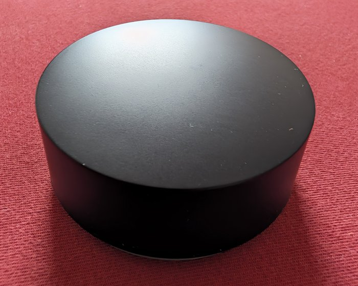
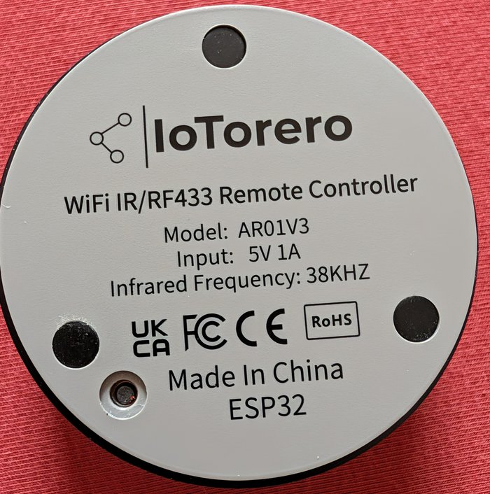
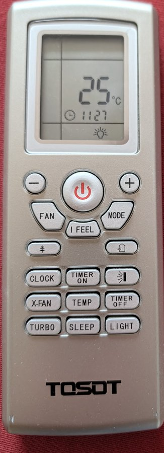
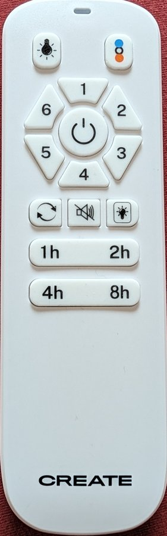
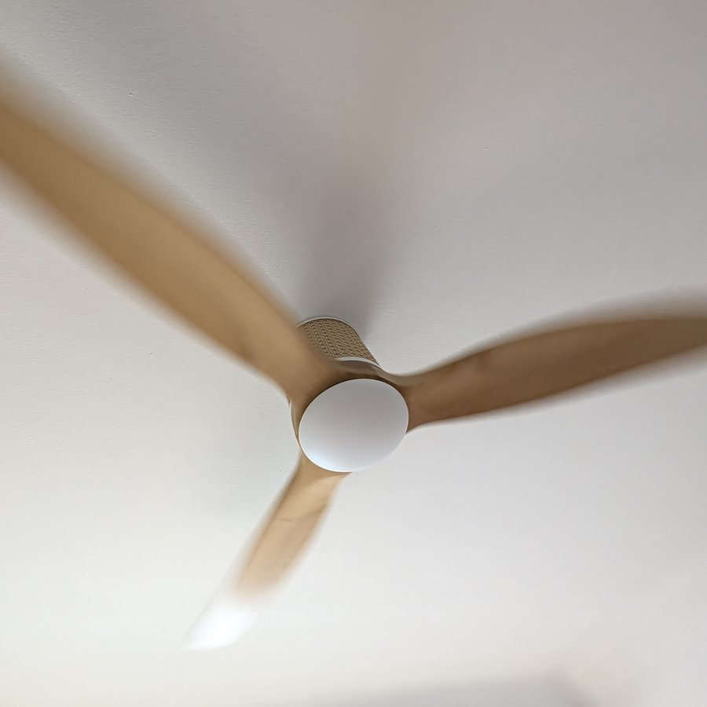

# Tasmota for IR + RF remote boxes

**One small box, two kinds of remote control:** infrared for your air
conditioner or TV, *and* 433 MHz radio for ceiling fans, blinds or radio
sockets. This project gives such a box a ready-made
[Tasmota](https://tasmota.github.io/docs/) firmware that can do both at the
same time.

<p align="center">
  
  &nbsp;&nbsp;
  
</p>

<p align="center">
  <a href="../../releases/latest"></a>
  <a href="../../actions/workflows/build.yml"></a>
  <a href="LICENSE"></a>
</p>

---

## Contents

1. [Why this exists](#why-this-exists)
2. [Will it work with my box?](#will-it-work-with-my-box)
3. [Install](#install)
4. [First setup](#first-setup)
5. [Using infrared](#using-infrared)
6. [Using 433 MHz radio](#using-433-mhz-radio)
7. [Updating](#updating)
8. [Versions and changelog](#versions-and-changelog)
9. [For tinkerers](#for-tinkerers)
10. [License and credits](#license-and-credits)

---

## Why this exists

I control my air conditioners from [Home Assistant](https://www.home-assistant.io/)
with little boxes like the one above. They send the same infrared signals as
the air conditioner's own remote. Then a ceiling fan with two lights moved
into the bedroom. Its remote looks similar, but it uses **433 MHz radio**
instead of infrared.

<p align="center">
  
  &nbsp;&nbsp;&nbsp;
  
  &nbsp;&nbsp;&nbsp;
  
  <br>
  <sub>Left: air conditioner remote, infrared. Middle: ceiling fan remote, 433 MHz radio. Right: the fan.</sub>
</p>

The box on the wardrobe has a 433 MHz radio chip built in. The official
Tasmota downloads just never switch on both halves together:

| Official download | Infrared for air conditioners (all brands) | 433 MHz radio |
|---|---|---|
| `tasmota32.bin` | only a few basic codes | yes |
| `tasmota32-ir.bin` | yes | **switched off** |
| **this project** | **yes** | **yes** |

So I built a version with both. Along the way I found that the fan's remote
uses a timing that none of Tasmota's built-in radio "languages" can send
correctly. I measured it with the box itself and added it as a new one
(protocol 41). Now one box per room handles the air conditioner *and* the
fan.

If you have a similar box and want the same, take the files from
[Releases](../../releases/latest). Nothing in them is specific to my home:
no Wi-Fi name, no passwords, no server addresses.

## Will it work with my box?

| Device | Status |
|---|---|
| **IoTorero AR01V3** "WiFi IR/RF433 Remote Controller" (label as in the photo above) | ✅ tested, several units |
| Athom "RF IR Remote" with ESP32 | should work (same pin layout), not tested by me |
| Other ESP32 boxes with IR and 433 MHz | may work with your own [template](https://tasmota.github.io/docs/Templates/) |
| Boxes with ESP8266 / ESP8285 | ❌ no, this firmware is for ESP32 only |

Look at the label on the bottom of your box. If it says **ESP32** and
**IR/RF433**, you are in the right place.

## Install

Every release has two firmware files. You only need one of them:

| File | When to use it |
|---|---|
| `tasmota32-ir-rf.bin` | Your box **already runs Tasmota**, i.e. its web page in the browser says "Tasmota". |
| `tasmota32-ir-rf.factory.bin` | Your box runs something else, or the first way did not work. |

Download them from the [latest release](../../releases/latest). Releases
marked *Pre-release* were built automatically and have not been tried on a
real box yet (see [Versions](#versions-and-changelog)).

### A. Your box already runs Tasmota

1. Open the box's web page in your browser, using its IP address (for example `http://192.168.1.50`).
2. Click **Firmware Upgrade**.
3. Under **Upgrade by file upload**, choose `tasmota32-ir-rf.bin` and click **Start upgrade**.
4. Wait about a minute. The box restarts on its own.
5. At the bottom of the main page, the version now ends in **(ir-rf-r…)**.

Your Wi-Fi and all other settings stay as they were. Continue with step 3 of
[First setup](#first-setup).

### B. Your box runs something else (USB cable, nothing to install)

The AR01V3 has a USB socket that doubles as a programming port.

1. Connect the box to your computer with a **USB data cable** (some cables can only charge).
2. Open **[web.esphome.io](https://web.esphome.io/)** in **Chrome or Edge** on a computer. Firefox and Safari cannot do this.
3. Click **Connect** and choose the port that appears (often called *USB Serial* or *CH340*).
4. Click **Install**, choose `tasmota32-ir-rf.factory.bin` and confirm.
5. When it says *Installation complete*, unplug the box and plug it into a normal USB power supply.

> No port in step 3? Your computer may need the
> [CH340 driver](https://www.wch-ic.com/downloads/CH341SER_EXE.html) (Windows and macOS).

## First setup

1. **Wi-Fi** (only after way B or on a reset box): The box opens its own
   Wi-Fi called `tasmota-XXXXXX-XXXX`. Connect your phone to it. A setup page
   opens; if not, go to `http://192.168.4.1`. Choose your Wi-Fi, enter the
   password, click **Save**.
2. **Find the box:** It now shows up in your router as `tasmota-XXXXXX-XXXX`.
   Open its IP address in the browser.
3. **Tell Tasmota which pins do what:** Go to **Tools → Console**, paste this
   line and press Enter:

   ```
   Backlog Template {"NAME":"IR RF Remote","ARCH":"ESP32","GPIO":[32,0,0,0,0,0,0,1,0,0,0,0,0,0,1120,1152,0,0,0,0,0,1056,0,544,0,0,0,0,0,1088,0,0,0,0,0,0],"FLAG":0,"BASE":1}; Module 0
   ```

   The box restarts. Without this step, infrared and radio do nothing.
4. **Get updates from this project:** In the console, type `OtaUrl 1` and
   press Enter. From then on, the **Start upgrade** button fetches the newest
   tested release from here (see [Updating](#updating)).

For Home Assistant, also enter your MQTT broker under **Configuration →
MQTT**. Tasmota's guide explains the details:
[MQTT](https://tasmota.github.io/docs/MQTT/).

## Using infrared

Everything in Tasmota's infrared guide works unchanged, including all
air-conditioner brands through `IRHVAC`:
[Tasmota IR Remote](https://tasmota.github.io/docs/Tasmota-IR/).

My air conditioner remote (TOSOT, model YT1F) speaks the GREE protocol. A
typical command in the console:

```
IRHVAC {"Vendor":"GREE","Power":"On","Mode":"Cool","Temp":24,"FanSpeed":"Auto"}
```

## Using 433 MHz radio

### 1. Find out what your remote sends

1. Open **Tools → Console** on the box.
2. Hold your remote near the box and press a button once.
3. A line like this appears:

   ```
   {"RfReceived":{"Data":"0xC67006E","Bits":29,"Protocol":2,"Pulse":704}}
   ```

4. Write down `Data`, `Bits`, `Protocol` and `Pulse` for every button you need.

Nothing appears? Your remote may use another frequency (315 or 868 MHz), or a
rolling code (car keys, many garage doors). Those cannot be copied.

### 2. Send it from the box

```
RfSend {"Data":"0xC67006E","Bits":29,"Protocol":2,"Pulse":704,"Repeat":10}
```

Most radio sockets and blinds react straight away. If your device ignores it,
its remote probably uses a timing Tasmota cannot reproduce exactly, just like
my fan. [docs/rf-remotes.md](docs/rf-remotes.md) shows step by step how I
measured and rebuilt it.

### CREATE ceiling fans

The CREATE ceiling fan remote (model K9678, photo above) is built in as
**protocol 41**. Send with **30 bits**:

```
RfSend {"Data":"0x18CE00DC","Bits":30,"Protocol":41,"Repeat":15}
```

Every remote has its own ID inside the code, so your codes will differ from
mine. [docs/rf-remotes.md](docs/rf-remotes.md#create-ceiling-fans) shows how
to turn what your box receives into the code to send, with the full button
table of my remote as an example.

### Home Assistant

Send any of the commands above from an automation or a script with the MQTT
action. `ir_box_bedroom` stands for your box's MQTT topic:

```yaml
action: mqtt.publish
data:
  topic: cmnd/ir_box_bedroom/RfSend
  payload: '{"Data":"0x18CE00DC","Bits":30,"Protocol":41,"Repeat":15}'
```

When someone uses the original remote, the box reports it on
`tele/ir_box_bedroom/RESULT` as `RfReceived`. Home Assistant can use that as a
trigger and keep its display in step with what really happened.

## Updating

If you did step 4 of [First setup](#first-setup) (`OtaUrl 1`):

1. Open the box's web page → **Firmware Upgrade**.
2. Click **Start upgrade** under *Upgrade by web server*.

The box fetches the newest **tested** release from this project and keeps all
settings. Pre-releases are never installed this way.

You can also download `tasmota32-ir-rf.bin` yourself and use *Upgrade by file
upload*, as in [Install, way A](#a-your-box-already-runs-tasmota).

> Do **not** point the update address back to the official Tasmota server.
> The official file would quietly remove the radio part again.

## Versions and changelog

Release names look like **`v15.4.0-r1`**:

- **`15.4.0`** is the Tasmota version inside.
- **`r1`** is the revision of this project's additions on top of it. If I
  improve something without a new Tasmota version, it becomes `r2`, and so on.

The box shows the same in the footer of its web page, for example
*Tasmota 15.4.0 (ir-rf-r1)*.

New Tasmota versions are picked up **automatically**. Every Monday, GitHub
checks for a new official Tasmota release, builds this firmware on top of it
and publishes it as a **pre-release**. Once it has run on a real box (air
conditioner switches, fan reacts to radio), it becomes a normal release, and
only then does the update button offer it.

What changed in each release is in [CHANGELOG.md](CHANGELOG.md).

## For tinkerers

- How the firmware is built, exactly what it changes in Tasmota, and how
  releases work: [docs/how-it-is-built.md](docs/how-it-is-built.md)
- Measuring and rebuilding a 433 MHz remote: [docs/rf-remotes.md](docs/rf-remotes.md)

## License and credits

This project builds on [Tasmota](https://github.com/arendst/Tasmota) by Theo
Arends and contributors, including the
[rc-switch](https://github.com/sui77/rc-switch) and
[IRremoteESP8266](https://github.com/crankyoldgit/IRremoteESP8266) libraries
that come with it. Like Tasmota, it is licensed under the
[GNU General Public License v3.0](LICENSE). The complete source of every
release is the official Tasmota version named in the release plus the files
in this repository.

This is a personal project, provided as is, without support. Issues are
switched off. If something does not work for you, the
[Tasmota community](https://tasmota.github.io/docs/Contributing/#support) is a
good place to ask.
